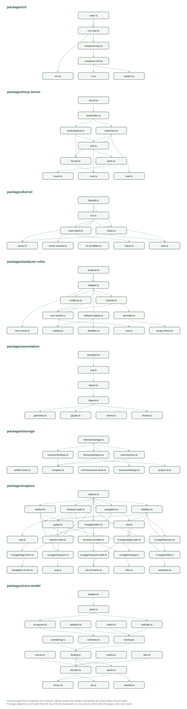

# FlawDot

> 🚧 **Work in progress.** FlawDot is in the design phase. There is no usable release yet.

FlawDot is a local tool for people who build websites. You give it a URL (`localhost` works too), and it finds
**UI, UX, accessibility (WCAG) and conversion** issues. It then returns a screenshot of the page with every problem
**circled and numbered**.

For each issue it tells you:

- what is wrong and why it matters
- how severe it is
- which principle it breaks (for example WCAG 1.4.3 or one of Nielsen's heuristics)
- how to fix it

## How it will work

```bash
npx flawdot
```

This starts a local server and opens the interface in your browser. From there you:

1. Enter a URL and choose a single page or the whole site, plus the viewports to test (desktop, tablet, mobile).
2. See the estimated time and cost before anything runs.
3. Get an interactive report with the annotated screenshot, the list of issues and a score for each category.
4. Export it as an annotated PNG, a PDF, or Markdown you can paste into an AI assistant.

## Planned approach

- **Capture** with Playwright: screenshots, DOM, bounding boxes and the accessibility tree.
- **Deterministic checks** with axe-core, marked as _Verified_.
- **AI review** with Claude vision, marked as _AI suggestion_ with a confidence level. You bring your own API key,
  which stays on your machine.
- **Local first**: everything runs on your computer, so FlawDot can check sites on `localhost` as well as public ones.

## Status

The product decisions are settled. Next come the wireframes, the technical spec and the first prototype.
Follow the repository for updates.

## Code map

This is how the modules of `core-model`, the shared domain package, depend on each other. The map is generated from
the code with [graphify](https://github.com/safishamsi/graphify), and it is redrawn when the structure changes.



You can explore the whole repository the same way. The full knowledge graph is not committed (it is rebuilt locally),
so it only exists after you generate it:

```bash
graphify . # builds graphify-out/ with GRAPH_REPORT.md, graph.html and graph.json
graphify query "where is the finding fingerprint computed?"
```

Read `graphify-out/GRAPH_REPORT.md` first to see the main modules and how they connect, and open only the files you
need.

## License

[MIT](LICENSE) © 2026 Alessio Pianaroli
