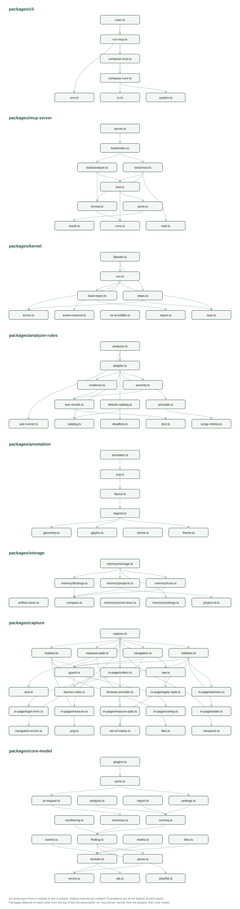

# @flawdot/core-model

The shared domain package of [FlawDot](../../README.md). It holds the types, the validation, the scoring and the
contracts that every other part of FlawDot builds on: the capture, the analyzers, the kernel, the MCP server and the web
app. It is a private workspace package, not published on its own.

It has **one runtime dependency, [Zod](https://zod.dev)**, and no I/O: no network, no file system, no browser. Every
function is pure, so the package runs the same in Node and in the browser, and it can be tested without any setup.



## What is inside

| Module                   | What it gives you                                                                                                                                                  |
| ------------------------ | ------------------------------------------------------------------------------------------------------------------------------------------------------------------ |
| `ids.ts`                 | Branded IDs (`ProjectId`, `RunId`, `FindingId`, `MarkId`), so a run ID cannot be passed where a finding ID is expected.                                            |
| `domain.ts`              | `Run`, `Capture`, `Element`, viewports, categories, severities and the schemas for them, with their invariants (for example, a run has an end time when finished). |
| `finding.ts`             | `FindingDraft` and `Finding`, `toFinding`, `normalizeSelector` and the `fingerprint` that identifies a problem across runs.                                        |
| `scoring.ts`             | The score formula: `categoryScore`, `pageScore`, `siteScore` and `band`.                                                                                           |
| `numbering.ts`           | `numberFindings`: the numbers of the circles drawn on the screenshot.                                                                                              |
| `schemas.ts`             | Strict schemas for what an AI (or Claude Code, through `record_findings`) sends back, and the JSON Schema given to the AI.                                         |
| `ai-request.ts`          | The AI request for one tile of a page, and `toDrafts`, which turns an answer into finding drafts and says what it dropped.                                         |
| `plugins.ts`, `ports.ts` | The interfaces that other packages implement: input, analyzers, AI fulfillers and providers, repositories, the secret store, the annotator and more.               |
| `settings.ts`            | The app settings, their limits and their defaults.                                                                                                                 |
| `errors.ts`, `parse.ts`  | `FlawDotError` with stable error codes, and `parseOrThrow` for every piece of data that comes from outside.                                                        |
| `events.ts`              | The progress events of a run.                                                                                                                                      |
| `sha256.ts`              | A SHA-256 in plain TypeScript, so fingerprints do not depend on `node:crypto`.                                                                                     |

Only what `src/index.ts` exports is the public contract.

## Design rules

- **Nothing from outside is trusted.** Data from an AI answer, a tool call or an HTTP body goes through `parseOrThrow`
  with a strict Zod schema. A key that was not asked for is an error, not something dropped in silence. Error messages
  are clipped, so a hostile input cannot fill a log.
- **Types come from schemas.** Each type is `z.infer` of its schema, so the type and the validation cannot drift apart.
- **No hidden state.** Scoring, numbering and fingerprints are functions of their input only. Scores are recomputed from
  the stored findings, so changing a constant changes every score shown, including the history.
- **Dependencies point one way.** The package imports nothing from the kernel or the plugins. Oxlint enforces it, and
  it also forbids import cycles.

## Examples

Turn what an analyzer found into a finding with a stable fingerprint:

```ts
import { toFinding } from "@flawdot/core-model";

const finding = toFinding(draft, {
  id,
  runId,
  pageUrl: "https://example.com/blog/my-post",
  templateKey: "/blog/:slug",
  viewport: "desktop",
  language: "en",
});
// finding.fingerprint is the same on /blog/other-post: it belongs to the template, not to the URL.
```

Read the answer of an AI for one tile, without trusting it:

```ts
import { parseAiResponse, toDrafts } from "@flawdot/core-model";

const response = parseAiResponse(rawAnswer); // throws AI_BAD_RESPONSE on a malformed answer
const { drafts, dropped } = toDrafts(response, capture, {
  model: "claude-code",
  category: "conversion",
  allowedRuleKeys,
});
// `dropped` says why a finding was left out: unknown mark, low confidence, duplicate or over the limit.
```

Score a page:

```ts
import { DEFAULT_WEIGHTS, band, categoryScore, pageScore } from "@flawdot/core-model";

const ui = categoryScore(uiFindings, states); // 0 to 100
const total = pageScore({ ui, ux: null, accessibility: 92, conversion: null }, DEFAULT_WEIGHTS);
// A category that was not analyzed is `null` and is left out of the total.
band(total ?? 0); // "excellent" | "good" | "needs_work" | "critical"
```

## The score

For each page, viewport and category: `score = 100 × e^(−penalty / 40)`. The penalty of a finding is 10 for critical,
4 for medium and 1 for low. Findings of the same rule are grouped: the group counts once, plus 10% for every extra
occurrence, up to twice. An AI suggestion weighs its confidence (0 to 1), and an ignored finding weighs nothing. The
total of a page is the weighted mean of the categories that were analyzed. The weights default to 25% each and the user
can change them. The constants are exported so they can be tuned on real sites.

## Working on it

Run these from the repository root:

```bash
pnpm check:fast   # types, lint and formatting
pnpm check:task   # also the tests and the coverage thresholds
```

Scoring, numbering and findings have a 100% coverage floor, and the rest of the package needs at least 90%.
